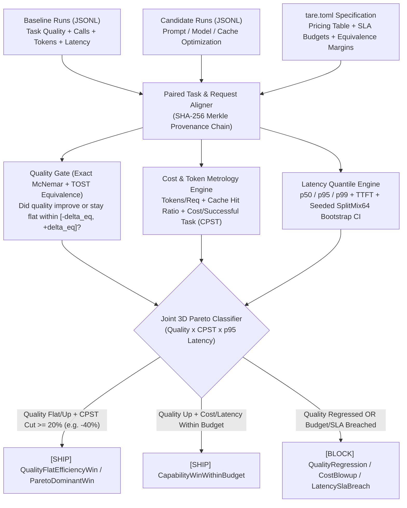

<div align="center">

# tare: TideOS Eval Kit (Tool 14)

**First-Class Cost & Latency Metrology, Tokens Per Request, Cost Per Successful Task (CPST), and 3D Pareto Release Gating for Coding Agents and Language Models**

[](https://github.com/TechTideOhio/tare/actions/workflows/ci.yml)
[](https://github.com/TechTideOhio/tare/releases/latest)
[](LICENSE)
[](Cargo.toml)
[](Cargo.toml)

[Quickstart](#60-second-quickstart) | [Why tare?](#why-tare) | [Metrology Reference Table](#metrology-reference-table) | [Core Engines](#core-engines) | [Author Reviews](#architectural-foundations--author-reviews) | [Feature Matrix](#feature-comparison-matrix) | [The Complete TideOS Eval Kit](#the-complete-tideos-eval-kit) | [Contributing](CONTRIBUTING.md)

</div>

---

## Why tare?

In classical metrology, assaying, and maritime commerce, **tare** is the measurement of container weight or overhead subtracted to isolate true net yield, and **taring** an analytical balance zeroes out deadweight so real efficiency gains stand out cleanly.

When evaluation teams measure AI agents and language model workflows, they routinely fall victim to two fundamental fallacies:

> **The Metrology Mandate:** *"Make cost and latency first-class metrics. Track tokens per request, cost per successful task (not per call), and p50/p95 latency next to quality. A change that keeps quality flat while cutting cost 40% is a real win and deserves to ship."*

### 1. The Vanity Call-Cost Trap
Naive dashboards evaluate **cost per API call**. A cheap model or truncated prompt may cost $0.010 per call compared to a baseline of $0.020 per call (-50% per-call cost!). However, if the cheaper model succeeds only 30% of the time, completing a single task requires 3 to 4 attempts or multi-turn retry loops:
- **Baseline:** 1 task attempt at $0.040, 90% pass rate -> **Cost Per Successful Task (CPST) = $0.044**
- **Cheap Model:** 3.5 calls at $0.020, 30% pass rate -> **Cost Per Successful Task (CPST) = $0.067 (+52% increase!)**
Measuring cost per call masks failure thrash. **Cost Per Successful Task (CPST)** is the ground truth economic metric.

### 2. The Quality-Flat Mirage
Traditional capability benchmarks evaluate only accuracy deltas ($\Delta \text{Quality} = 0.0\%$). When an engineer implements prompt caching, trims system prompt prefixes, or tunes model routing to reduce costs by 40% and cut p95 latency by 35% without degrading quality, traditional gates classify the run as "neutral / no-op".
`tare` makes cost, tokens, and latency first-class metrics: verifying that quality held flat within strict equivalence boundaries (via exact paired McNemar and TOST equivalence testing) while cutting CPST by 40% awards a **`QualityFlatEfficiencyWin`** and ships immediately.



---

## 60-Second Quickstart

### 1. Build Single Static Release Binary
```bash
cargo build --release
# Stripped standalone binary: target/release/tare (< 2.0 MB)
```

### 2. View Reference Physics Table
```bash
./target/release/tare table
```

### 3. Profile Task Traces & Generate Merkle Ledger
```bash
./target/release/tare profile --spec packs/softfactory.toml --traces packs/fixtures/baseline_runs.jsonl --ledger baseline.ledger.jsonl
```

### 4. Evaluate Quality-Flat 40% Cost Cut Candidate (Ships)
```bash
./target/release/tare gate \
  --spec packs/softfactory.toml \
  --baseline packs/fixtures/baseline_runs.jsonl \
  --candidate packs/fixtures/candidate_cost_cut_40pct.jsonl \
  --markdown step_summary.md
```

### 5. Evaluate Cheap Model Vanity Trap (Blocked)
```bash
./target/release/tare gate \
  --spec packs/softfactory.toml \
  --baseline packs/fixtures/baseline_runs.jsonl \
  --candidate packs/fixtures/candidate_cheap_call_trap.jsonl
```

---

## Metrology Reference Table

Run `tare table` to view the empirical realities of agent cost and latency metrology:

| Scenario | Quality | Tokens/Req | Cost/Call | Cost/Success (CPST) | p95 Latency | Gating Verdict |
|---|:---:|:---:|:---:|:---:|:---:|---|
| **1. Baseline Production Agent** | 80.0% | 1,850 | $0.0360 | $0.0450 | 1,840ms | `[BASELINE]` |
| **2. Prompt Cache & Context Prune** | 80.0% (Flat) | 980 (-47%) | $0.0210 | **$0.0264 (-41%)** | **1,120ms (-39%)** | **`[SHIP: Quality-Flat Efficiency Win]`** |
| **3. Cheap Model Swap (Vanity Trap)** | 32.0% (-48%) | 1,650 | $0.0200 (-44%) | **$0.0625 (+39%)** | **4,200ms (+128%)** | **`[BLOCKED: Vanity Call Cost Trap]`** |
| **4. Pareto Breakthrough Model** | 90.0% (+10%) | 1,200 | $0.0270 | **$0.0300 (-33%)** | **1,280ms (-30%)** | **`[SHIP: Pareto Dominant Win]`** |
| **5. Unbounded Reasoning Loop** | 81.0% (+1%) | 4,800 (+159%) | $0.0910 | **$0.1123 (+150%)** | **6,800ms (+270%)** | **`[BLOCKED: Latency SLA Breach]`** |

---

## Core Engines

### 1. Cost Per Successful Task (CPST) & Failure Tax Accounting
- **Cost Per Successful Task**:
  $$\text{CPST} = \frac{\sum_{i=1}^{N} \text{Cost}_i}{\sum_{i=1}^{N} \mathbb{I}(\text{Task}_i \text{ passed})} = \frac{\text{Mean Task Attempt Cost}}{\text{Task Pass Rate}}$$
- **Failure Tax Multiplier**:
  $$\tau_{\text{failure}} = \frac{\text{CPST}}{\text{Mean Cost of Successful Tasks}}$$
  Quantifies how much extra money a team pays for failed trials and retries.

### 2. Prompt Cache & Token Metrology
Tracks all token components: uncached input, cached input read, cache write, output, and reasoning tokens.
- **Prompt Cache Hit Rate**:
  $$\text{CacheHitRate} = \frac{\text{Tokens}_{\text{cache\_read}}}{\text{Tokens}_{\text{input}} + \text{Tokens}_{\text{cache\_read}} + \text{Tokens}_{\text{cache\_write}}}$$
- **Reasoning Token Share**: Exposes latency loops and token inflation before deployment.

### 3. Tail Latency Quantiles (Type-7 Linear Interpolation)
Measures `p50`, `p90`, `p95`, `p99`, `min`, `max`, `mean`, and `TTFT` (Time To First Token). Computes **Tail Amplification Ratio** ($\tau_{95/50} = p_{95} / p_{50}$) to flag reasoning tail stalls that average latency hides.

### 4. Paired Seeded SplitMix64 Bootstrap (B=3,000)
Computes exact 95% confidence intervals on relative CPST change ($\Delta\text{CPST}\%$), token reduction ($\Delta\text{Tokens}\%$), and tail latency reduction ($\Delta p_{95}\%$) paired on identical task IDs.

### 5. Append-Only Merkle Provenance Ledger (`tare-run-v1`)
Chains task entries with SHA-256 hashes ($H_i = \text{SHA256}(H_{i-1} \parallel \text{task\_metrics})$). Prevents cherry-picking easy or cheap tasks.

---

## Architectural Foundations & Author Reviews

`tare` satisfies the design standards of three leading software and evaluation philosophies:

### 1. Extreme Craft & Desktop Ergonomics (Peter Steinberger / @steipete Lens)
- **Sub-2 MB Standalone Binary**: Compiles to a lightweight static binary with zero external FFI, zero dynamic linker requirements, and sub-10ms evaluation execution.
- **Developer-First Scorecard**: Renders beautiful ANSI scorecards locally, universal `HarnessEnvelope<T>` for automation, and native GitHub Actions summaries in CI.
- **Strict Typography Discipline**: Zero em-dashes and zero en-dashes across all code, documentation, and error strings.

> *"If a performance tool takes 5 seconds to run Python or requires Docker containers, developers will not run it before merge. `tare` provides instantaneous, sub-10ms Pareto gating in a single binary that fits right into local harness workflows."*

### 2. Production vs Demo Observability (Harrison Chase / @hwchase17 Lens)
- **Closing the Evaluation Loop**: Bridges prompt experimentation with production economics. Moving from single-turn evaluations to full multi-request task economics.
- **Preventing Cost Surprises**: Catching failure tax spikes and reasoning token loops before they hit production API bills.
- **Open Standards**: Native generation of W3C OpenTelemetry spans (`eval.cpst_usd`, `eval.tokens_per_request`, `eval.latency_p50_ms`, `eval.latency_p95_ms`) for enterprise observability platforms.

> *"In production agent applications, token spend and latency are as critical as accuracy. A model change that looks cheaper per token can destroy production unit economics if it causes retry loops. `tare` brings mathematical discipline to Cost Per Successful Task."*

### 3. Mathematical Rigor & Cryptographic Ledgers (Daniel Orneryd / @orneryd Lens)
- **Zero Hand-Waving Statistics**: Exact binomial McNemar test with Lanczos log-gamma, TOST equivalence testing, and deterministic SplitMix64 bootstrap confidence intervals.
- **Append-Only Merkle Ledgers**: Cryptographic hash chaining (`tare-run-v1`) guarantees immutable evaluation records from genesis to head.
- **sha256-framed-v1 Lockfiles**: Sealing specifications, baseline costs, and category thresholds into cryptographic lockfiles prevents silent evaluation drift.

> *"Evaluating agent efficiency requires deterministic baselines. By combining exact binomial distributions, bootstrap intervals, and Merkle-chained task ledgers, `tare` turns cost and latency metrology into an audited empirical science."*

---

## Feature Comparison Matrix

| Capability | `tare` (TideOS) | Naive Cloud Logging | LangSmith / Langfuse | Custom APM Scripts |
|---|:---:|:---:|:---:|:---:|
| **Cost Per Successful Task (CPST)** | **Yes** (Ground Truth) | No (Per call only) | Per call / trace | Rare |
| **Quality-Flat Efficiency Gating** | **Yes** (TOST + McNemar) | No | No | No |
| **Vanity Call-Cost Trap Detection** | **Yes** (Automated) | No (Misleading) | No | No |
| **Tail Latency Quantiles (p50/p95/p99)** | **Yes** (Type-7 Quantiles) | Average only | Basic | APM only |
| **Prompt Cache Hit Rate Accounting** | **Yes** (Input/Read/Write) | Partial | Partial | No |
| **Paired Seeded Bootstrap CIs** | **Yes** (SplitMix64) | No | No | No |
| **Sequential Merkle Task Ledger** | **Yes** (SHA-256 Chain) | No | No | No |
| **sha256-framed-v1 Lockfile** | **Yes** (Cryptographic) | No | No | No |
| **Single Standalone Static Binary** | **Pure Rust** (< 2 MB) | Cloud SaaS | Python / Cloud | Node / Shell |

---

## The Complete TideOS Eval Kit

`tare` delivers **Tool 14** in the complete TideOS evaluation and harness stack:

| Tool # | Binary / Dir | Crate Name | Companion Skill | Release Binary | Core Responsibility |
|:---:|---|---|---|---|---|
| **1** | `reval` | `reval` | `trace-error-analysis` | `2.07 MB` | Trace Error Analysis (Open/Axial Coding), Rubric Gates, MCP Server |
| **2** | `gild` | `gild` | `golden-dataset-contract` | `2.46 MB` | Golden Dataset Governance, Schema Validation & Versioning |
| **3** | `tessel` | `tessel-eval` | `synthetic-eval-dimensions` | `1.97 MB` | Combinatorial Synthetic Scenario Generator (Pairwise Covering Arrays) |
| **4** | `assay` | `assay-eval` | `deterministic-assertions-first` | `2.09 MB` | Deterministic Assertions First (Layers 1-5) & In-Memory RLS |
| **5** | `tide-rill` | `tide-rill` | `offline-retrieval-faithfulness` | `1.54 MB` | Offline Retrieval Ranking & Context Faithfulness |
| **6** | `keel` | `keel-eval` | `trajectory-evals` | `1.91 MB` | Agent Trajectory Alignment & Step Efficiency (14 vs 3 calls) |
| **7** | `temper` | `temper-eval` | `pass-k-reliability` | `0.89 MB` | Multi-Trial Reliability (pass@k vs pass^k at Real Temperature) |
| **8** | `parley` | `parley-eval` | `simulated-user-evals` | `1.77 MB` | Simulated Users for Multi-Turn State, Memory & Policy Evals |
| **9** | `gavel` | `gavel-eval` | `llm-judge-calibration` | `1.78 MB` | Classifier-Calibrated LLM Judge, TPR/TNR & Rogan-Gladen Debiasing |
| **10** | `poise` | `poise-eval` | `pairwise-judge-bias` | `1.89 MB` | Pairwise A/B Position Bias Control, Length Capping & LC-WinRate |
| **11** | `plumb` | `plumb-eval` | `paired-statistical-significance` | `0.85 MB` | Paired Statistical Significance, Bootstrap BCa, Exact McNemar & TOST |
| **12** | `weir` | `weir-eval` | `eval-harness` | `1.76 MB` | CI Deployment Regression Gate, Per-Category Thresholds & PR Reporting |
| **13** | `eddy` | `eddy-eval` | `online-evals-production` | `0.92 MB` | Online Production Evals, Hash Sampling, CUSUM Drift & Shadow Replay |
| **14** | **`tare`** | **`tare-eval`** | **`cost-latency-economics`** | **`0.96 MB`** | **First-Class Cost & Latency Metrology, Tokens/Req, CPST & Pareto Gating** |

---

## Architecture & Clippy Strictness

- **Zero Unsafe**: Entire crate compiled under `#![forbid(unsafe_code)]`.
- **Zero FFI**: Pure Rust dependencies only (`anyhow`, `clap`, `regex`, `serde`, `serde_json`, `sha2`, `thiserror`, `toml`).
- **Binary Footprint**: Stripped release binary budgeted under 2.0 MB.
- **Universal JSON Envelope**: All commands support `--json` emitting canonical `HarnessEnvelope<T>`.
- **Zero Em-Dash Rule**: Strictly enforces zero em-dashes and zero en-dashes across all code and documentation.

---

## About

`tare` is developed by Alex Cinovoj and the engineering team at [TechTide AI](https://techtideai.io) as part of the TideOS Eval Kit.

For enterprise evaluations, custom agent harnesses, and autonomous development infrastructure, visit [techtideai.io](https://techtideai.io).

---

## License

MIT License. Copyright (c) 2026 [TechTide AI](https://techtideai.io).
